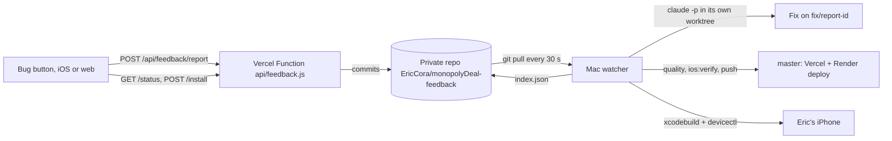

# Problem reports, fixed automatically

Spec: `docs/specs/2026-11-12-report-and-autofix.md`.



## Pieces
- **Button:** `apps/ios/App/Report/` and `src/ui/report/`. It's off unless switched on in Settings (Developer). Builds made by the watcher have the report key built in, so it's on in them.
- **Inbox:** `api/feedback.source.ts` (bundled to `api/feedback.js` by `npm run build:turn-api`), with the logic in `apps/server/src/feedbackInbox.ts`. Reports live in the private repo, never in Vercel Blob, so they can't use up the turn rooms' limits.
- **Watcher:** `scripts/feedback/watcher.mjs`, with its decisions in `plan.mjs` and its instructions to Claude in `fix-prompt.md`. It does one thing at a time:
  1. An install Eric asked for.
  2. A reply to a question.
  3. The oldest new report.

  Each report gets a worktree in `~/Developer/monopolyDeal-feedback-work/` and a headless `claude -p --permission-mode auto` session. The watcher, not Claude, runs `npm run quality` (plus `npm run ios:verify` when `apps/ios/` or `src/engine/` changed), rebases, and pushes to `master`. A failed check goes back to the same session, at most three times.

## One-time setup
1. **Vercel environment variables** (Project, Settings, Environment Variables, Production):
   - `FEEDBACK_REPORT_KEY`: the `reportKey` from the watcher config below.
   - `FEEDBACK_GITHUB_TOKEN`: a fine-grained GitHub token. Limit it to the repository `EricCora/monopolyDeal-feedback`, with permission Contents: Read and write.
   - `FEEDBACK_GITHUB_REPO` is optional and defaults to `EricCora/monopolyDeal-feedback`.

   Redeploy after setting them.
2. **Watcher config** at `~/.config/monopolydeal-feedback/config.json` (mode 600, never committed):
   ```json
   { "deviceId": "<from xcrun devicectl list devices>", "reportKey": "<long random string>" }
   ```
   Optional keys override the defaults at the top of `watcher.mjs`: `repo`, `apiBase`, `pollSeconds`, `push`.
3. **Start it:** `scripts/feedback/install-agent.sh`. The log is in `~/Library/Logs/MonopolyDealFeedback/watcher.log`.
4. **First install:** tap Install in the app once, or run `node scripts/feedback/watcher.mjs --once` after making an install request. The app on the phone then has the key built in.
5. **Web:** open Settings, turn on Report Button and paste the key. It's stored only in that browser.

## Limits
- The Mac has to be awake and logged in. Reports wait while it's asleep.
- Installs need the phone on the same Wi-Fi as the Mac, or plugged in. The watcher waits up to 6 hours, then marks the install failed.
- The free signing profile lasts about 7 days. Each install renews it.
- The key in an installed app can be read by anyone who has that app file. It can only post reports and read their status.

## Testing it
- `npx vitest run src/test/feedback-inbox.test.ts src/test/feedback-watcher-plan.test.ts src/test/report-button.test.tsx`
- iOS: the `ReportUITests` UI tests. With `TEST_RUNNER_REPORT_E2E_NOTE="..."` in the environment, the button test sends a real report to the inbox the build points at, set with `DEAL_REPORT_API`.
- Dry run: `node scripts/feedback/watcher.mjs --once --no-push`. It fixes and verifies one report without pushing.
